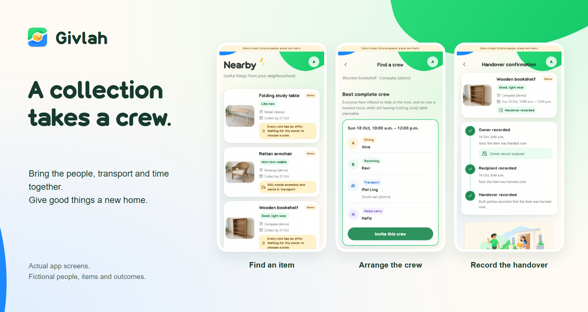
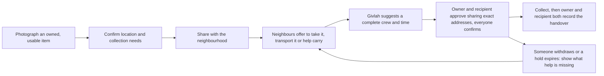

<div align="center">


# Givlah

### Give usable items a new home, with the people, transport and time to collect them.

<p>Good things. New homes. Together.</p>

<p>Built for the <a href="https://www.simedarbyproperty.com/universityhackathon/">Sime Darby Property University Hackathon 2026 (Township of Tomorrow)</a>.</p>

<a href="https://givlah.vercel.app"></a>
<a href="https://www.youtube.com/watch?v=JkXULAtTk6Y"></a>

<br>
<br>

<a href="https://givlah.vercel.app"></a>

**Python 3.12+ · Django 5.2 · SQLite · Progressive Web App**

</div>

## Start here

**[Explore Givlah](https://givlah.vercel.app)** for the walkthrough, mechanism, privacy rules and local setup, or **[watch the 3-minute captioned demo](https://www.youtube.com/watch?v=JkXULAtTk6Y)**. No sound is needed.

The documentation site and video are live. The interactive app is a working local prototype; a public app instance is not hosted yet. All demo people, places, items and outcomes are fictional.

## Watch the demo

**[Play on YouTube →](https://www.youtube.com/watch?v=JkXULAtTk6Y)**

Follow a bookshelf from its photo and neighbours' offers to a compatible crew, private-location approvals, four individual confirmations and two separate handover records. A second item shares the same people and van, so its collection uses a different time. The video explicitly labels its simulated advance to collection time; no physical handover or real-world impact is claimed.

## The problem

Someone has a usable bookshelf they no longer need, and a neighbour wants it. But the neighbour has no car, and the shelf needs two people to carry. Finding someone interested still leaves the collection to arrange. Givlah connects those separate offers into a complete plan that everyone can confirm.

Read the **[research, gap and alternatives](docs/RESEARCH.md)** for the public sources, competitor comparison and what remains unvalidated.

## How Givlah works



What makes Givlah different:

- **Complete arrangements, not likes.** A collection is ready only when it has a recipient, someone to transport the item (or carry it locally) and an extra helper if one is needed. All of them must be free for the whole trip.
- **No double-booking.** Givlah plans across several listings at once. It never books the same person or vehicle into overlapping trips, and it explains why a listing can't be planned yet.
- **Everyone confirms for themselves.** A proposed crew is held briefly. It becomes Ready only after every participant confirms the same version of the plan. Any change requires fresh confirmations.
- **Honest recovery.** If someone withdraws, the plan returns to "needs help" with the missing role shown. Once a collection may have started, the item is never automatically relisted.
- **Handover takes two records.** A collection counts as complete only after the owner and the recipient each record the handover separately.

## Privacy by design

- Public listings show only a neighbourhood area, never an exact location.
- Exact pickup and drop-off details are visible only to the selected crew. Both the owner and the recipient must approve sharing them, and access ends when the plan changes or closes.
- Location is requested only when you tap the button for it, and you can always enter it by hand.
- Photos are re-encoded with location and camera metadata removed. Originals are never stored.
- No phone numbers or emails are shown publicly. There are no analytics or third-party trackers.

## Architecture at a glance

Givlah is a **mobile web app (PWA)** served by **Django**:

- Server-rendered Django 5.2 templates, designed for phones first.
- Camera capture through the browser's file input, and location through the Geolocation API.
- Coordination rules (matching, holds, confirmations and handovers) implemented as plain Python service functions, kept separate from the views.
- SQLite with short serialized write transactions for the local prototype.
- No paid services, external APIs or background workers on the critical path.

Full details are in [docs/ARCHITECTURE.md](docs/ARCHITECTURE.md).

## Documentation

| Document | Contents |
| --- | --- |
| [docs/RESEARCH.md](docs/RESEARCH.md) | Problem evidence, competitors and alternatives, the targeted gap and validation limits |
| [docs/PRODUCT.md](docs/PRODUCT.md) | Users, workflow, prototype scope, screens and visual direction |
| [docs/SPECIFICATION.md](docs/SPECIFICATION.md) | Records, matching rules, plan states, privacy rules, failure handling and acceptance checks |
| [docs/ARCHITECTURE.md](docs/ARCHITECTURE.md) | Client choice, components, data model, transactions, PWA behaviour and testing approach |

## Repository layout

```
apps/           Django apps: accounts, listings, offers, coordination, core (clock, action tokens), pwa
givlah/         Django project settings and URLs
templates/      Mobile-first page templates
static/         CSS, progressive-enhancement JS, app icons and illustrations
assets/brand/   App icon sources (SVG and 2048 x 2048 PNG)
docs/           Research summary, product, specification and architecture documents
site/           Static documentation and demo site, hosted separately
```

See [docs/ARCHITECTURE.md](docs/ARCHITECTURE.md#project-layout) for how the pieces fit together.

## Getting started

Requires Python 3.12 or newer.

```bash
python -m venv .venv
# Windows: .venv\Scripts\activate    macOS/Linux: source .venv/bin/activate
pip install -r requirements.txt
python manage.py migrate
python manage.py load_demo          # optional: fictional demo locality, people and items
python manage.py runserver
```

Open http://localhost:8000 and create an account. To try the labelled demo accounts, start the server with `GIVLAH_DEMO_MODE=1`. Run the tests with `python manage.py test`.

In demo mode, open the account avatar and use **Try another demo person** to switch roles during a walkthrough. Crew members stay on the current collection plan, with their own approvals and confirmations; someone without access returns to Nearby. This switcher is unavailable outside demo mode.

On a phone, `http://<your-computer's-IP>:8000` works for browsing and photos, but browsers only allow location and app installation over HTTPS, so enter the pickup location manually there. Settings are listed at the top of [givlah/settings.py](givlah/settings.py).

## Contributing

Givlah is developed by a small core team, and only team members can contribute code. Bug reports and feedback are welcome as issues. Team members should follow [CONTRIBUTING.md](CONTRIBUTING.md). Report security issues as described in [SECURITY.md](SECURITY.md).

## Acknowledgements

Developed with the help of AI coding tools. The in-app illustrations and the demo item photos were generated with AI image tools; the photos show fictional items, not real listings.

## License

This repository is a submission to the Sime Darby Property University Hackathon 2026 and is not released under an open-source licence. Rights in it are governed by the [programme terms](https://www.simedarbyproperty.com/universityhackathon/terms-and-conditions/); see [LICENSE](LICENSE). Third-party components keep their own licences.
