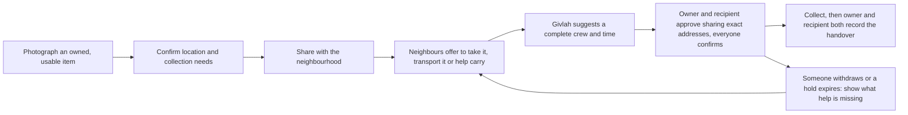

<p align="center">
  
</p>

<h1 align="center">Givlah</h1>

<p align="center"><strong>Good things. New homes. Together.</strong></p>

Givlah helps neighbours give usable household items a new home. It does more than find someone who wants an item. It arranges the people, transport and time needed to actually collect it.

> **Status: early development.** Accounts, item listings with privacy-safe photos and location, and the installable app shell work today. Neighbour offers and collection planning are being built next.

## The problem

Someone has a usable bookshelf they no longer need, and a neighbour wants it. But the neighbour has no car, and the shelf needs two people to carry. Giveaway groups help people find each other, but that is where they stop. The item often ends up waiting or thrown away because nobody can organise the collection.

## How Givlah works



What makes Givlah different:

- **Complete arrangements, not likes.** A collection is ready only when it has a recipient, someone to transport the item (or carry it locally) and an extra helper if one is needed. All of them must be free for the whole trip.
- **No double-booking.** Givlah plans across several listings at once. It never books the same person or vehicle into overlapping trips, and it explains why a listing can't be planned yet.
- **Everyone confirms for themselves.** A proposed crew is held briefly. It becomes Ready only after every participant confirms the same version of the plan. Any change requires fresh confirmations.
- **Honest recovery.** If someone withdraws, the plan returns to "needs help" with the missing role shown. Once a collection may have started, the item is never automatically relisted.
- **Handover takes two records.** A collection counts as complete only after the owner and the recipient each record the handover separately.

## Privacy by design

- Public listings show only a neighbourhood area, never an exact location.
- Exact pickup and drop-off details are visible only to the selected crew. Both the owner and the recipient must approve sharing them, and access ends when the plan changes or closes.
- Location is requested only when you tap the button for it, and you can always enter it by hand.
- Photos are re-encoded with location and camera metadata removed. Originals are never stored.
- No phone numbers or emails are shown publicly. There are no analytics or third-party trackers.

## Architecture at a glance

Givlah is planned as an **installable mobile web app (PWA)** served by **Django**:

- Server-rendered Django 5.2 templates, designed for phones first.
- Camera capture through the browser's file input, and location through the Geolocation API.
- Coordination rules (matching, holds, confirmations and handovers) implemented as plain Python service functions, kept separate from the views.
- SQLite with short serialized write transactions for the local prototype.
- No paid services, external APIs or background workers on the critical path.

Full details are in [docs/ARCHITECTURE.md](docs/ARCHITECTURE.md).

## Documentation

| Document | Contents |
| --- | --- |
| [docs/PRODUCT.md](docs/PRODUCT.md) | Users, workflow, prototype scope, screens and visual direction |
| [docs/SPECIFICATION.md](docs/SPECIFICATION.md) | Records, matching rules, plan states, privacy rules, failure handling and acceptance checks |
| [docs/ARCHITECTURE.md](docs/ARCHITECTURE.md) | Client choice, components, data model, transactions, PWA behaviour and testing approach |

## Repository layout

```
apps/           Django apps: accounts, listings, core (clock, action tokens), pwa
givlah/         Django project settings and URLs
templates/      Mobile-first page templates
static/         CSS, progressive-enhancement JS and app icons
assets/brand/   App icon sources (SVG and 2048 x 2048 PNG)
docs/           Product, specification and architecture documents
```

See [docs/ARCHITECTURE.md](docs/ARCHITECTURE.md#project-layout) for how the pieces fit together.

## Getting started

Requires Python 3.12 or newer.

```bash
python -m venv .venv
# Windows: .venv\Scripts\activate    macOS/Linux: source .venv/bin/activate
pip install -r requirements.txt
python manage.py migrate
python manage.py load_demo          # optional: fictional demo locality, people and items
python manage.py runserver
```

Open http://localhost:8000 and create an account. To try the labelled demo accounts, start the server with `GIVLAH_DEMO_MODE=1`. Run the tests with `python manage.py test`.

On a phone, `http://<your-computer's-IP>:8000` works for browsing and photos, but browsers only allow location and app installation over HTTPS, so enter the pickup location manually there. Settings are listed at the top of [givlah/settings.py](givlah/settings.py).

## Contributing

Givlah is developed by a small core team, and only team members can contribute code. Bug reports and feedback are welcome as issues. Team members should follow [CONTRIBUTING.md](CONTRIBUTING.md). Report security issues as described in [SECURITY.md](SECURITY.md).

## Acknowledgements

Developed with the help of AI coding tools.

## License

[MIT](LICENSE)
