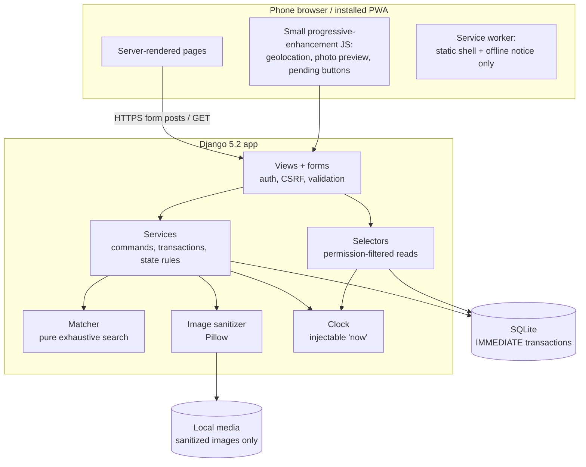
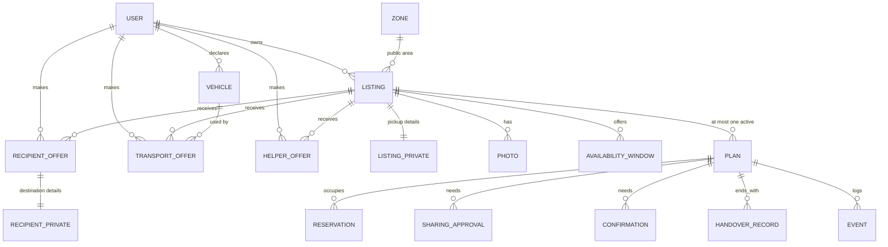
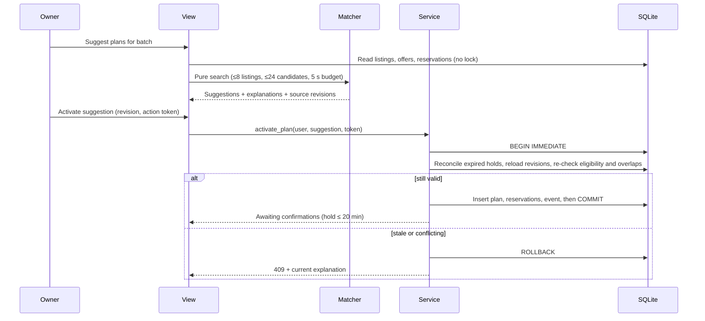

# Givlah architecture

Status: **in progress**, 15 October 2026. Built so far: accounts, listings, photo sanitizing, location input, private pickup storage, the PWA shell, neighbour offers the full coordination lifecycle (matching, holds, approvals, confirmations, withdrawals and handover records), private-data retention and outcome totals. Behaviour is defined in [SPECIFICATION](SPECIFICATION.md) and scope in [PRODUCT](PRODUCT.md). When this document and the specification disagree about behaviour, the specification wins.

## Client decision: installable mobile web app

Givlah is built as a **server-rendered Django web app that phones can install as a PWA**. There is no separate native client.

| Concern | Choice and reason |
| --- | --- |
| One codebase | Accounts, permissions, private-location rules and coordination all live in a single Django app. A native client would add a JSON API, token auth, a second permission surface and checks on both sides, and private data could leak through any of those extra layers. |
| Device features | Photos come from `<input type="file" accept="image/*" capture="environment">`. Location comes from the browser Geolocation API, requested only on an explicit tap. These cover everything the prototype needs. |
| Distribution | Anyone with a link can open the app, and it can be added to the home screen. No app-store accounts, fees or review are needed. |
| Scaling | Scaling depends on the server and database, not on the client. A native client would not make the coordination engine scale better. |
| Limits accepted | Phone GPS and PWA installation need an HTTPS origin, although `localhost` is exempt. Web push is weaker on iOS, but push is outside the prototype. There is no offline mode, because coordination needs current server state. |
| Future native path | Coordination rules are plain service functions that don't depend on views or HTTP. If push or background features become central later, a JSON API and a native client (e.g. Expo/React Native) can call the same services without rewriting the rules. |

## System overview



Rules for each layer:

- **Views** parse the request, check authentication and call a single service or selector. They never change models directly.
- **Services** are the only code that writes coordination state, and that includes admin actions. Each service takes the acting user from the session, never from posted IDs.
- **Selectors** build what a page shows for the requesting user. Private fields are omitted entirely unless the specification's access rule allows them, so hiding something in a template never counts as protection.
- **Matcher** is a pure function over plain data (listings, offers, existing reservations and a time). It has no database access, so it can be tested exhaustively.

## Project layout


```
manage.py
givlah/                 Django project: settings, root urls, wsgi
apps/
  core/                 clock.py (injectable now), ActionToken (safe resubmission)
  accounts/             User model (display name, synthetic flag), login, demo-mode account switch
  listings/             Listing, photos, zones, private pickup details, image sanitizer, load_demo command
  offers/               Recipient, transport and helper offers; shared Vehicle records
  coordination/
    models.py           Plan, Reservation, SharingApproval, Confirmation, HandoverRecord, Event, ActionToken
    matcher.py          Candidate generation + exhaustive selection (pure)
    services.py         activate, approve/revoke, confirm/decline, withdraw, record/retract handover
    selectors.py        Status and private-detail reads per user
  pwa/                  Manifest, service worker and offline page views
templates/              Mobile-first templates and shared components
static/                 CSS (palette tokens), minimal JS, generated app icons
assets/brand/           Icon sources
docs/
```

Dependencies are deliberately few:

- **Django 5.2 LTS:** web framework, auth, ORM, migrations, admin.
- **Pillow:** decoding, rotating, resizing and re-encoding uploaded photos.

Anything else gets added only when there's a concrete need, and is recorded here along with the reason.

## Data model



Key points:

- **Private details are stored in separate tables.** `LISTING_PRIVATE` and `RECIPIENT_PRIVATE` hold exact locations and addresses. Only the private-detail selector reads them, and only when the requester is in the current plan, both location owners have approved this plan revision, and the plan state and seven-day window allow it. Event text never copies addresses.
- **Every listing, offer and plan has a revision counter.** Mutations carry the revision they were based on. A mismatch returns HTTP 409 together with the current state.
- **Reservations use half-open intervals.** Each one stores a person or vehicle identity plus a `[start, end)` interval in UTC. A plan reserves each distinct person once, even when they fill several roles.
- **Database constraints:**
  - A partial unique index on `Plan(listing)` for active states (awaiting confirmations, ready, awaiting handover record) allows one active plan per listing.
  - Uniqueness on (plan, revision, participant) for confirmations and approvals.
  - Uniqueness on (plan, party) for handover records.
  - A unique `ActionToken` per submitted form, so a resubmitted request returns the committed result.
- **Overlap is checked in application code.** SQLite has no exclusion constraints, so services check for overlapping intervals inside the serialized write transaction (see below).
- **Times are stored in UTC.** `TIME_ZONE = "Asia/Kuala_Lumpur"` is used for display, with `USE_TZ = True`.

## Coordination flow



How the matcher works:

1. **Candidate generation.** For each listing, combine the owner, an eligible recipient, an eligible transport offer (with its vehicle, if any) and a distinct helper if one is required. Use only exact shared windows, and record why any combination was rejected.
2. **Selection.** Run a backtracking search that assigns at most one candidate to each listing. Pruning rejects any branch that reuses a person or vehicle in an overlapping interval, and also any branch that can no longer beat the best count found so far. The goal is the most complete handovers. Ties go to the earlier deadline, then the older listing, then the stable ID.
3. **Batch.** The batch for a listing is every open listing connected to it through a shared person or vehicle (owner or offer). Listings outside that group can't affect its plan, so solving the group exactly gives the same answer as solving everything at once, without an arbitrary cut-off.
4. **Limits.** More than eight listings or 24 candidates in the batch returns an explicit over-limit result. Hitting the five-second budget returns an incomplete result. Neither case is ever presented as optimal.
5. **Output.** Suggestions reserve nothing. Only `activate` creates a hold. The owner sees the best crew, other feasible crews, and which other listings a choice would block.

## Transactions and concurrency

The configuration below is for a local prototype:

- `DATABASES["default"]["OPTIONS"] = {"transaction_mode": "IMMEDIATE", "timeout": 5}`. Each write transaction takes the database write lock at `BEGIN`, so concurrent writers are serialized. A writer that waits more than 5 seconds gets a retryable "busy, try again" response and is never retried in an infinite loop.
- `ATOMIC_REQUESTS` is off. Services open short `transaction.atomic()` blocks only around the writes. Matching, image decoding and network calls never happen inside a transaction.
- Every write service follows the same order: reconcile time-based state using the clock, reload rows and compare revisions, validate, then write state, reservations and events together. Any exception rolls back everything.
- `select_for_update()` does nothing on SQLite, so correctness comes from serialized `IMMEDIATE` transactions and from re-validating inside them.
- **No background worker.** Holds, collection start and data-retention expiry are derived from `clock.now()` on every read and write, and expired private data is purged on the next request or at startup.

Scaling note: SQLite and a single process are choices for the prototype. A public multi-user deployment would move to PostgreSQL, where row locks, `select_for_update()` and exclusion constraints on time ranges become available. The services keep the same interfaces, and the concurrency checks must be run again.

## Privacy and security controls

| Area | Control |
| --- | --- |
| Identity | Django session auth. The actor always comes from `request.user`. A demo-mode account switch exists only when `GIVLAH_DEMO_MODE` is on, and it is visibly labelled. |
| Mutations | POST only, with CSRF on every form. Server-side action tokens and revisions make retries safe. Buttons are disabled while a request is pending, as a convenience rather than a guarantee. |
| Authorization | Object-level checks in services and selectors. Outsiders get a non-disclosing 404 for private objects, and participants get 403 for actions that aren't theirs. |
| Location | The public view shows only a named zone and its representative point, with no exact distances. GPS is requested only on tap, once, with a 10-second timeout, and the owner confirms the result. Manual entry is always available. |
| Photos | 1-3 images per listing, each at most 5 MiB and 12 MP, in JPEG, PNG or WebP only. Each image is decoded, rotated according to its EXIF orientation, resized to a longest edge of 1600 px, re-encoded with all metadata stripped and saved under a random name. Originals and user-supplied paths are never stored or served. |
| Logging | Logs never contain exact locations, addresses or image bytes. No analytics or third-party scripts. |
| Cookies | `Secure`, `HttpOnly` and `SameSite=Lax` whenever the app is served over HTTPS. |

## PWA behaviour

- **Manifest** (`/manifest.webmanifest`): name `givlah`, `display: standalone`, theme green `#10C766`, background `#FDFCFD`. Icons at 192 and 512 px, plus a maskable variant, are generated from `assets/brand/givlah-icon.png`.
- **Service worker** (`/sw.js`, scoped to the site root):
  - Precaches only versioned static assets (CSS, JS, icons) and an offline notice page.
  - HTML, authenticated responses, media and anything carrying private data always go to the network and are never cached.
  - With no connection, navigation shows the offline notice ("You're offline. Nothing was sent."). It never shows a stale page that could misrepresent plan state.
- **No JS required for core flows.** Forms work as plain HTML. JavaScript adds the geolocation button, photo preview and pending-state buttons.

## Running on a phone during development

- On `localhost` on the development machine, everything works, including geolocation, because browsers treat localhost as a secure origin.
- A phone loading `http://<LAN-IP>:8000` gets pages, forms and photo capture, but browsers block geolocation and PWA installation on a plain-HTTP origin. In that case the manual-location fallback applies, exactly as the specification requires.
- Testing GPS or installation on a real phone needs an HTTPS origin, such as a local certificate or a secure tunnel. Which one to use will be decided when real-device checks start, and it is not a build dependency.

No hosting or deployment has been chosen yet.

## Testing approach

- Use the Django test runner against a real SQLite database. No test makes a network call or uses credentials.
- **Matcher:** fixed scenarios from the specification (G04-G07) plus generated small inputs compared with an independent brute-force enumerator (G08), and a timing check on the size limit (G09).
- **Services:** separate users exercising permissions, state transitions, expiry under an injected clock, withdrawals and handovers (G02, G12-G18).
- **Concurrency:** two real database connections in separate threads activate conflicting plans, and only one may succeed (G10). Failures are injected partway through writes to prove rollback (G11).
- **Images:** crafted, disguised, oversized and GPS-tagged files (G03).
- **Rendered UI:** a browser at phone and desktop widths, covering keyboard use, error states and rejected requests (G01, G19).

Mocks are used only at external boundaries, such as browser geolocation responses, and are labelled as mocks. Results are recorded against the commit they were run on.
